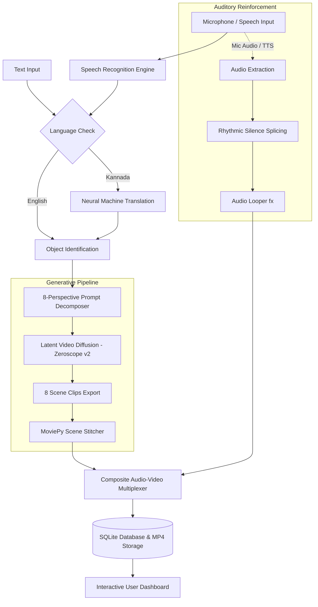

# Titan: Multimodal Speech-to-Video Generation Framework

[](https://www.python.org/)
[](https://pytorch.org/)
[](https://huggingface.co/cerspense/zeroscope_v2_576w)
[](https://flask.palletsprojects.com/)
[](LICENSE)

> **Assistive Generative AI for Specially Abled Education**  
> An end-to-end framework translating spoken language into multi-perspective synthetic video scenes synchronized with rhythmic auditory reinforcement loops.

---

## 📖 Overview

Children with special needs—especially those with hearing impairments, cognitive learning challenges, or Attention Deficit Hyperactivity Disorder (ADHD)—often face difficulties in building mental representations from static text or isolated flashcards.

**Titan** is a multi-modal Speech-to-Video system designed to revolutionize vocabulary and object comprehension. By integrating **Speech Recognition**, **Multilingual Neural Translation (Kannada & English)**, **Multi-Perspective Prompt Decomposition**, **Latent Video Diffusion (Zeroscope v2)**, and an **Auditory Focus Feedback Loop**, Titan autonomously synthesizes comprehensive, 8-scene educational video clips from a single voice command.

### 🔬 Academic Research

This repository contains the official prototype implementation of the research paper:
> **"Multimodal Speech-to-Video Generation Framework for Object Learning in Specially Abled Education"**  
> *Authors: Sandesh P Y, Dr. Hamsaveni M*  
> *Department of Computer Science & Engineering, Vidyavardhaka College of Engineering, Mysuru, India*

---

## ✨ Key Features

- **🎙️ Dual-Channel Voice & Text Input**:
  - Voice capture directly in-browser using the Web Audio API.
  - Integration with Google Speech Recognition for live acoustic transcription.
  - Supports English (`en-US`) and regional languages such as Kannada (`kn-IN`).

- **🌐 Real-Time Neural Translation**:
  - Automatically converts regional vocabulary (e.g., Kannada terms) into English contextual descriptors required by generative vision backbones via `deep-translator`.

- **🎬 8-Perspective Scene Decomposition**:
  - Instead of generating a single ambiguous clip, Titan structures 8 distinct viewpoint prompts for each object:
    1. *Stationary Frontal View*
    2. *Forward Motion Towards Camera*
    3. *Dynamic Kinetic Action (Jumping / Moving)*
    4. *Lateral Movement (Left)*
    5. *Lateral Movement (Right)*
    6. *High-Detail Macro Close-Up*
    7. *360-Degree Axial Rotation*
    8. *High-Illumination Final Showcase*

- **⚡ Latent Video Diffusion Engine**:
  - Built on `cerspense/zeroscope_v2_576w` with DPMSolverMultistepScheduler.
  - Features memory-efficient CPU offloading and attention slicing to enable generation across diverse hardware configurations.

- **🔁 Auditory Focus Loop**:
  - Extracts the user's authentic spoken voice (or fallback neural TTS via `gTTS`).
  - Automatically splices rhythmic 2-second silence intervals and loops the audio seamlessly across the video duration to reinforce learning and stimulate attention.

- **💻 Modern Full-Stack Web Application**:
  - Responsive, glassmorphic UI built with Flask, Jinja2, and custom CSS.
  - User authentication (Bcrypt encrypted passwords, Flask-Login sessions).
  - Background asynchronous task worker with live progress polling.
  - Personal video library dashboard with streaming playback and MP4 downloads.

---

## 🏛️ System Architecture



---

## 📁 Repository Structure

```text
Speech-to-Video/
├── app.py                         # Main Flask application & AI processing pipeline
├── requirements.txt               # Python package dependencies
├── run.bat                        # Windows one-click automated startup script
├── .gitignore                     # Git ignore rules for virtualenvs, caches & media
├── Sandesh_PY_Research_Paper.pdf  # Published / submitted research paper
├── Sandesh_PY_Research_Paper.docx # Research documentation and methodology
├── templates/                     # Frontend Jinja2 templates
│   ├── base.html                  # Base layout with navigation and footer
│   ├── index.html                 # Landing page & feature showcase
│   ├── dashboard.html             # Video studio, audio recorder & saved library
│   ├── login.html                 # User authentication login portal
│   └── signup.html                # User registration portal
├── static/                        # Static UI assets
│   ├── css/
│   │   └── style.css              # Glassmorphic responsive stylesheet
│   └── js/
│       ├── main.js                # Core UI scripts and interactions
│       └── dashboard.js           # Audio recording, API polling & live status handler
├── uploads/                       # User audio uploads (.wav/.mp3)
└── generated_videos/              # Final rendered MP4 output clips
```

---

## 🛠️ Installation & Setup

### 1. Prerequisites
- **Python**: Version `3.10` or `3.11` recommended.
- **FFmpeg**: Required by `moviepy` and `imageio-ffmpeg` for video rendering.
- **Hardware**: 
  - *Recommended*: NVIDIA GPU with at least 8 GB VRAM (CUDA 11.8+ / 12.1+).
  - *CPU Fallback*: Supported via PyTorch attention slicing (longer inference times).

### 2. Clone the Repository
```bash
git clone https://github.com/sandeshpy613/speech-to-video-diffusion.git
cd speech-to-video-diffusion
```

### 3. Create and Activate a Virtual Environment
```bash
# Windows
python -m venv venv
venv\Scripts\activate

# Linux / macOS
python3 -m venv venv
source venv/bin/activate
```

### 4. Install Dependencies
```bash
pip install --upgrade pip
pip install -r requirements.txt
```

> **Note on PyTorch with CUDA**: If running on an NVIDIA GPU, ensure PyTorch is installed with CUDA support:
> ```bash
> pip install torch torchvision torchaudio --index-url https://download.pytorch.org/whl/cu121
> ```

---

## 🚀 Running the Application

### Option A: One-Click Startup (Windows)
Double-click `run.bat` or run:
```cmd
run.bat
```

### Option B: Manual Execution
```bash
python app.py
```

Once initialized, open your browser and navigate to:
```
http://localhost:3000
```

> **Default Admin Account**:
> - **Username**: `admin`
> - **Password**: `admin123`

---

## 🎮 How It Works

1. **Sign Up / Log In**: Create an account or sign in with your credentials.
2. **Select Input Mode**:
   - **Voice**: Click the microphone icon, select your speaking language (English or Kannada), and record your word (e.g., *"ಆನೆ"* or *"Aeroplane"*).
   - **Text**: Enter any object or vocabulary noun in the input field.
3. **Generate**: Click **Generate Video**. The pipeline initializes background processing:
   - Recognizes and translates the text.
   - Generates 8 distinct visual camera perspectives.
   - Compiles audio with the rhythmic focus loop.
4. **View & Download**: Inspect real-time progress. Once complete, preview the video in your browser or download the `.mp4` file for offline educational sessions.

---

## 📊 Experimental Evaluation

Tested with common educational vocabulary objects:

| Input Object | Input Language | Generated Scenes | Auditory Feedback | Output Status |
| :--- | :--- | :--- | :--- | :--- |
| **Aeroplane** | English | 8 Scenes | Synchronized Looping | ✅ Successful |
| **Dog** | English / Kannada | 8 Scenes | Synchronized Looping | ✅ Successful |
| **Lion** | English / Kannada | 8 Scenes | Synchronized Looping | ✅ Successful |
| **Tree** | English | 8 Scenes | Synchronized Looping | ✅ Successful |

---

## 🤝 Citation & Reference

If you use this project or research in your work, please cite:

```bibtex
@article{sandesh2026multimodal,
  title={Multimodal Speech-to-Video Generation Framework for Object Learning in Specially Abled Education},
  author={Sandesh, P. Y. and Hamsaveni, M.},
  journal={Department of Computer Science \& Engineering, Vidyavardhaka College of Engineering},
  year={2026}
}
```

---

## 📜 License

Distributed under the **MIT License**. See `LICENSE` for more information.
